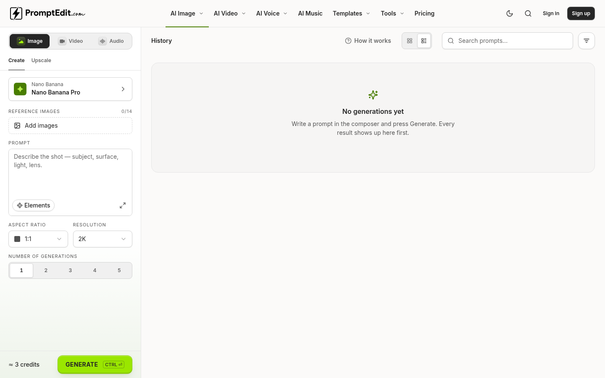
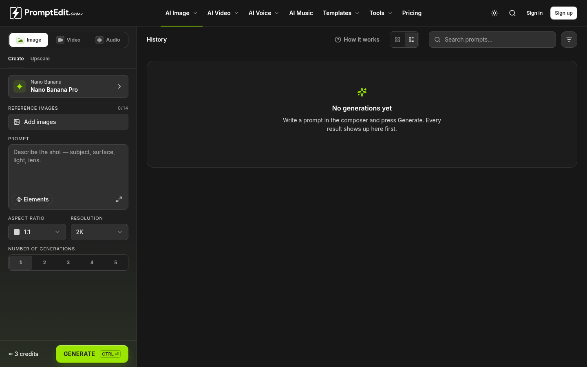

# Design

Pixelforge Studio follows the visual patterns of promptedit.com so it feels like part of that product. It copies the style (colors, type, radius, spacing, controls), never the brand: no logo, no "PromptEdit" name, no copied copy.

## How the values were captured

A throwaway Playwright script (outside the repo, system Chrome) opened three pages at 1440 px and 390 px, in light and dark `colorScheme`, waited for the client render and saved screenshots to `docs/design/reference/`. It then read computed styles (`getComputedStyle`) of the header, sidebar, main area, buttons, inputs, segmented controls and cards. The theme variables were read from the site's stylesheet, because the CSS is served cross-origin and the CSSOM is not readable from the page.

| Page        | Why                                                                                                                                             |
| ----------- | ----------------------------------------------------------------------------------------------------------------------------------------------- |
| `/` (home)  | Display type, CTA, marketing tone                                                                                                               |
| `/ai/image` | The image studio: composer on the left, history on the right. This is the closest match to Generate and History, and the main source of tokens. |
| `/pricing`  | Credits and price presentation                                                                                                                  |

Screenshots: `docs/design/reference/{home,ai-image,pricing}-{1440,390}-{light,dark}.png`. Raw computed values: `docs/design/reference/computed-all.json`.

## Tokens

Defined in `resources/css/app.css` as CSS variables (`:root` and `.dark`) and exposed to Tailwind through `@theme inline`. Components use only these tokens.

| Token                                   | Light                  | Dark                      | Measured on                             |
| --------------------------------------- | ---------------------- | ------------------------- | --------------------------------------- |
| `background` (page)                     | `#fbfaf9`              | `#171717`                 | `<main>` and header of `/ai/image`      |
| `card` (panels, sidebar)                | `#ffffff`              | `#1f1f1f`                 | composer `<aside>`                      |
| `foreground`                            | `#262626`              | `#ffffff`                 | headings, body text                     |
| `muted-foreground`                      | `#595959`              | `rgb(255 255 255 / .8)`   | paragraph and field labels              |
| `subtle-foreground`                     | `#6b6b6b`              | `rgb(255 255 255 / .6)`   | inactive tabs, counters                 |
| `control` (input/select bg)             | `#ffffff`              | `#303030`                 | select, model picker                    |
| `input` (control border)                | `#d4d4d4`              | `#454545`                 | select, segmented control               |
| `border` (panel dividers, cards)        | `#e5e5e5`              | `rgb(255 255 255 / .1)`   | header bottom, aside right, empty state |
| `secondary` / `muted` (segmented track) | `#f0f0f0`              | `#303030` / `#1d1d1d`     | Image/Video/Audio switch, 1-5 picker    |
| `sunken` (empty state fill)             | `rgb(38 38 38 / .024)` | `rgb(255 255 255 / .024)` | "No generations yet" card               |
| `primary` (dark solid button)           | `#262626` on `#fff`    | `#fff` on `#262626`       | "Sign up", active segment               |
| `brand` (main CTA)                      | `#9ae600` on `#262626` | same                      | GENERATE button                         |
| `brand-ink` (accent icon/text)          | `#497d00`              | `#9ae600`                 | sparkle icon in empty state             |
| `warning`                               | `#faa23d`              | `#ffa538`                 | site theme variable                     |
| `destructive`                           | `#ef4444`              | `#ef4343`                 | site theme variable                     |
| `ring`                                  | `#d6d3d1`              | `#d4d4d4`                 | site theme variable                     |

### Type

| Use                                | Font                | Size / weight                       |
| ---------------------------------- | ------------------- | ----------------------------------- |
| UI (everything in the studio)      | Inter               | 14 px / 400-600, body 16 px         |
| Section label                      | Inter, uppercase    | 11 px / 400, letter-spacing 0.88 px |
| Panel title ("History")            | Inter               | 14 px / 600                         |
| Main CTA                           | Inter, uppercase    | 14 px / 700, letter-spacing 0.35 px |
| Display headings (marketing, auth) | Bricolage Grotesque | 24-36 px / 700, tracking -0.025em   |
| Mono eyebrow, exact amounts        | Roboto Mono         | 12 px / 400, tracking 1.2 px        |

### Radius and shadow

| Element                                 | Radius                |
| --------------------------------------- | --------------------- |
| Segment item                            | 4 px (`rounded-sm`)   |
| Inputs, selects, small buttons          | 8 px (`rounded-md`)   |
| Main CTA, segmented track, icon buttons | 12 px (`rounded-xl`)  |
| Cards and empty states                  | 16 px (`rounded-2xl`) |
| Chips                                   | full                  |

- `shadow-control`: `0 1px 2px rgb(38 38 38 / .08)` on controls (dark: inset hairline).
- `shadow-cta`: inset highlight + inset bottom edge + soft lime glow, only on the main CTA.

## Components and layout patterns

- **Header**: 64 px, page background, 1 px bottom border, nav links 14 px / 600, dark solid button on the right.
- **Studio layout** (Generate): fixed-width composer column (~336 px) with a right border and a white card background, a subtle green gradient at the bottom; the main column shows History on the page background. On mobile the composer stacks above the history.
- **Field label**: uppercase 11 px muted label above each control, counter right-aligned (`0/4`).
- **Segmented control**: track `secondary` with 2 px padding, 12 px radius, `input` border; active item is a `control` chip with border and `shadow-control`, inactive items are `subtle-foreground` text.
- **Dashed add button**: "Add images" uses a 1 px dashed `input` border.
- **Composer footer**: sticky bottom bar with the cost on the left ("≈ 3 credits" on the site; for us the estimated price range) and the lime CTA on the right.
- **Empty state**: `sunken` fill, `border`, 16 px radius, 64 px vertical padding, centered `brand-ink` sparkle icon, 16 px / 600 title and 14 px muted text.
- **Tone**: short, direct, plain sentences ("Write a prompt in the composer and press Generate. Every result shows up here first.").
